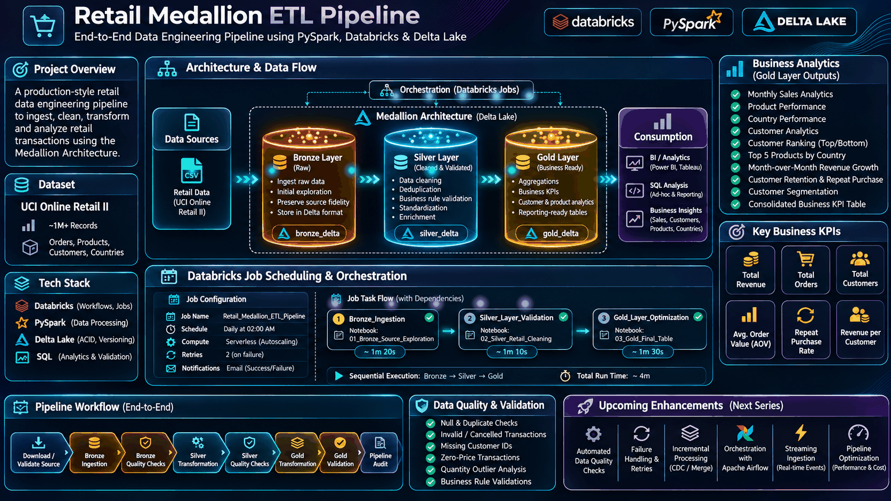

# Retail Medallion ETL Pipeline



**End-to-end data flow:** source ingestion → Bronze → Silver → Gold → analytics. The animation is a visual overview; scheduling details and settings shown within it are illustrative unless explicitly verified in the project Job configuration.

An end-to-end batch data engineering project built with **Databricks, PySpark and Delta Lake**, using the UCI Online Retail II dataset. The project explores ingestion, data profiling, quality investigation, cleaning, business transformation, analytical tables, and Databricks Job orchestration.

> This is a learning/portfolio project. The batch pipeline and analytical tables are implemented. Items identified as planned in the roadmap are not represented as implemented functionality.

## Architecture


### Medallion layers
- **Bronze:** ingest the source CSV into a Delta table and profile the source (schema, nulls, duplicates, anomalies).
- **Silver:** isolate relevant sales records, investigate and handle duplicates, standardize text, recover descriptions where mappings are reliable, retain unresolved nulls/anomalies where business context warrants it, validate and persist the cleaned data.
- **Gold:** derive transaction-line revenue and build business analytical tables and KPIs.

### Orchestration
Three notebooks are configured as a Databricks Job with sequential dependencies:

`Bronze_Ingestion → Silver_Layer_Validation → Gold_Layer_Optimization_And_Final_Table`

Tasks use Databricks Serverless compute. Job repair/rerun behavior was explored during pipeline execution.

## Dataset
**Online Retail II** (UCI Machine Learning Repository). It contains retail transaction records across two periods. The source data is not included in this repository. See [`data/README.md`](data/README.md) for source and setup notes.

## Notebooks
1. [`01_Bronze_Source_Exploration.ipynb`](notebooks/01_Bronze_Source_Exploration.ipynb)
2. [`02_Silver_Retail_Cleaning.ipynb`](notebooks/02_Silver_Retail_Cleaning.ipynb)
3. [`03_Gold_Final_Table.ipynb`](notebooks/03_Gold_Final_Table.ipynb)

## Implemented Gold analytics
- Monthly sales
- Product performance
- Country performance and average order value
- Customer analytics and ranking
- Top five products per country (rank ties may yield more than five rows)
- Month-over-month revenue growth
- Customer retention and repeat-purchase analytics
- Customer segmentation
- Consolidated business KPI table
- Gold validation and reconciliation steps in the Gold notebook

## Data-quality decisions (high level)
- Exact duplicate records investigated and removed from the sales dataset.
- Credit/cancellation and other negative-quantity records were investigated and excluded from the normal-sales analytical dataset according to the project's classification.
- Bad-debt adjustment records were identified separately.
- Missing product descriptions were recovered only where the StockCode-to-description mapping was reliable; unresolved values remain.
- Missing Customer IDs remain unidentified rather than being fabricated; customer-level metrics exclude unidentified IDs where appropriate.
- Zero-price and large-quantity records were investigated and retained where no defensible basis for removal was established.
- Core Silver business-rule validation was performed.

See [`documentation/Silver_Layer.md`](documentation/Silver_Layer.md) for detail.

## Tech stack
- Databricks notebooks and Jobs
- PySpark / Spark SQL
- Delta Lake
- Python
- GitHub for source control and documentation

## Repository layout
```text
.
├── README.md
├── .gitignore
├── architecture/
├── data/
├── documentation/
└── notebooks/
```

## Planned enhancements
- More automated and reusable data-quality checks
- Pipeline audit/logging improvements
- Incremental processing
- Retry and recovery design beyond current job-repair exploration
- Apache Airflow orchestration
- Simulated streaming ingestion
- Performance and cost optimization

These are roadmap items, not currently implemented features.

## Reproduce
1. Obtain the dataset from the UCI source (see `data/README.md`).
2. Upload it to a Databricks Volume using the location/path configured in Notebook 01, or update that path for your environment.
3. Run the Bronze notebook, then Silver, then Gold; alternatively, configure/run the Databricks Job using the task dependencies.
4. Review the validations and generated Delta tables in the `workspace.ecommerce` schema.

The notebooks contain environment-specific paths and table names; adjust them to your workspace as needed.

## License
The project code and documentation may be shared under the MIT License if you add one. Dataset rights and terms are governed by the dataset's original source; see `data/README.md`.
