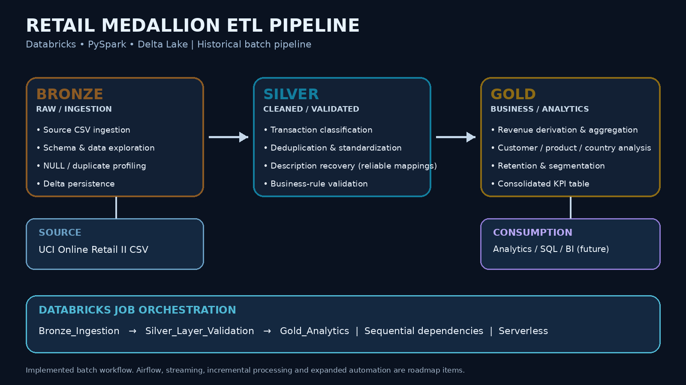

# Retail Medallion ETL Pipeline

An end-to-end batch data engineering project built with Databricks, PySpark and Delta Lake, using the UCI Online Retail II dataset. The project explores ingestion, data profiling, quality investigation, cleaning, business transformation, analytical tables, and Databricks Job orchestration.

## Architecture



### Medallion layers

- **Bronze:** ingest the source CSV into a Delta table and profile the source (schema, nulls, duplicates, anomalies).
- **Silver:** isolate relevant sales records, investigate and handle duplicates, standardize text, recover descriptions where mappings are reliable, retain unresolved nulls/anomalies where business context warrants it, validate and persist the cleaned data.
- **Gold:** derive transaction-line revenue and build business analytical tables and KPIs.

### Orchestration

Three notebooks are configured as a Databricks Job with sequential dependencies:

`Bronze_Ingestion → Silver_Layer_Validation → Gold_Layer_Optimization_And_Final_Table`

Tasks use Databricks Serverless compute. Job repair/rerun behavior was explored during pipeline execution.

## Dataset

**Online Retail II** (UCI Machine Learning Repository). It contains retail transaction records across two periods. The source data is not included in this repository. See [`data/README.md`](data/README.md) for source and setup notes.

## Notebooks

1. [`01_Bronze_Source_Exploration.ipynb`](notebooks/01_Bronze_Source_Exploration.ipynb)
2. [`02_Silver_Retail_Cleaning.ipynb`](notebooks/02_Silver_Retail_Cleaning.ipynb)
3. [`03_Gold_Final_Table.ipynb`](notebooks/03_Gold_Final_Table.ipynb)

## Implemented Gold analytics

- Monthly sales
- Product performance
- Country performance and average order value
- Customer analytics and ranking
- Top five products per country (rank ties may yield more than five rows)
- Month-over-month revenue growth
- Customer retention and repeat-purchase analytics
- Customer segmentation
- Consolidated business KPI table
- Gold validation and reconciliation steps in the Gold notebook

## Data-quality decisions (high level)

- Exact duplicate records investigated and removed from the sales dataset.
- Credit/cancellation and other negative-quantity records were investigated and excluded from the normal-sales analytical dataset according to the project's classification.
- Bad-debt adjustment records were identified separately.
- Missing product descriptions were recovered only where the StockCode-to-description mapping was reliable; unresolved values remain.
- Missing Customer IDs remain unidentified rather than being fabricated; customer-level metrics exclude unidentified IDs where appropriate.
- Zero-price and large-quantity records were investigated and retained where no defensible basis for removal was established.
- Core Silver business-rule validation was performed.

See [`documentation/Silver_Layer.md`](documentation/Silver_Layer.md) for detail.

## Tech stack

- Databricks notebooks and Jobs
- PySpark / Spark SQL
- Delta Lake
- Python
- GitHub for source control and documentation

## Repository layout

```text
.
├── README.md
├── .gitignore
├── architecture/
├── data/
├── documentation/
└── notebooks/